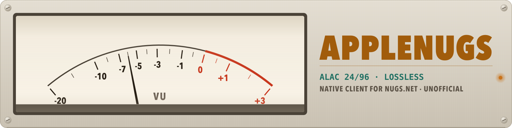
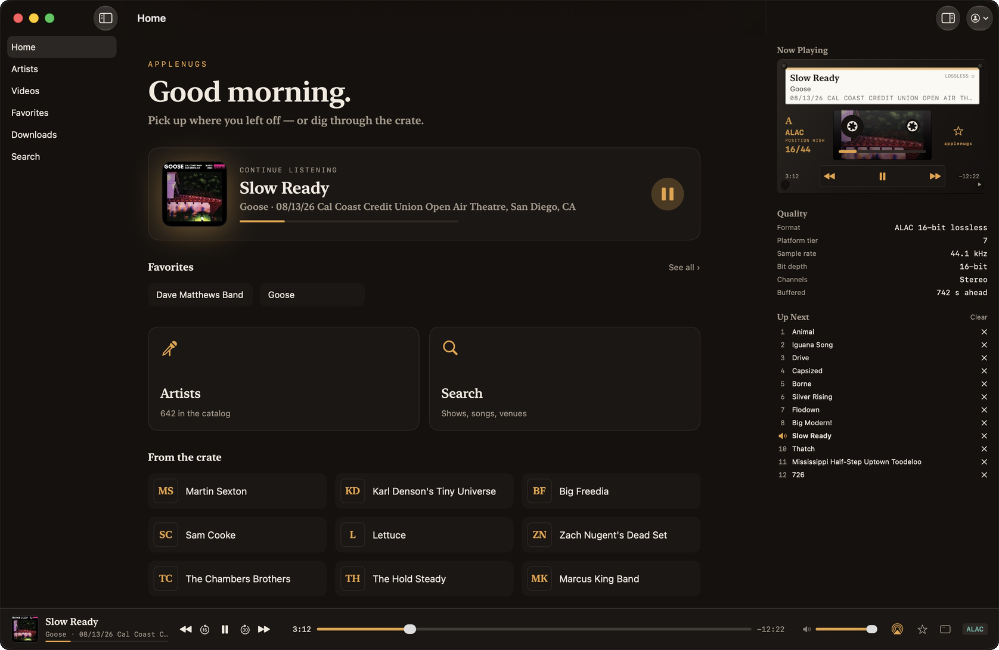
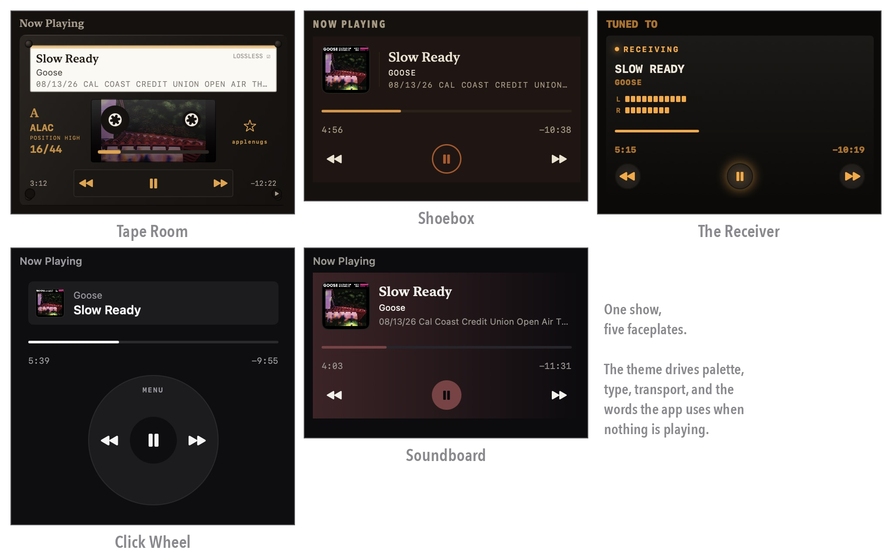
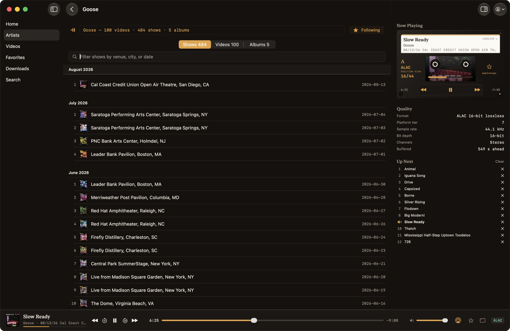
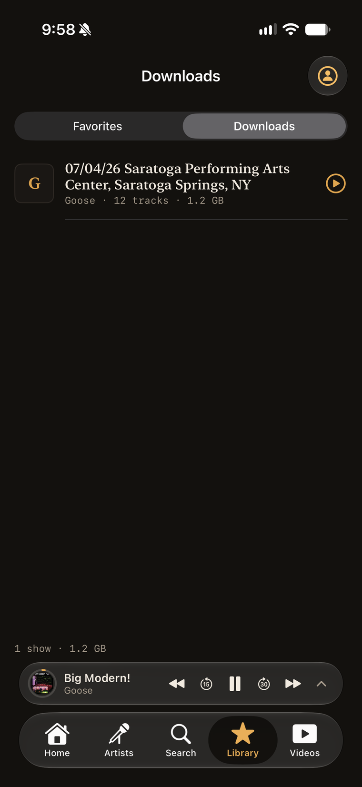

<div align="center">

<picture>
  <source media="(prefers-color-scheme: dark)" srcset="docs/images/banner-dark.svg">
  <!-- TODO(yeti): the banner's lettering is outlined paths that still read "AppleNugs".
       Regenerate both SVGs with the Yeti wordmark (swift scripts/generate-banner.swift),
       then update this alt text to match. -->
  
</picture>

Yeti is an unofficial player for nugs.net. Not affiliated with, authorized, sponsored or endorsed by nugs.net or Apple. Requires your own nugs.net subscription.

[](https://github.com/tsvb/applenugs/actions/workflows/ci.yml)
[](https://github.com/tsvb/applenugs/releases/latest)
[](https://github.com/tsvb/applenugs/releases/latest)
[](LICENSE)

</div>

Yeti is an unofficial native Mac and iPhone player for [nugs.net](https://nugs.net), built by
one person for one subscription. A real queue, gapless segues so a live set doesn't break at the
seams, offline shows on the phone, lossless where nugs offers it, and five front panels borrowed
from the gear this music was recorded on. It plays what your subscription already gives you, and
nothing else.

**Why Yeti?** It's named for the Goose song "Yeti." The project began life as AppleNugs, which
is why the repository, the bundle identifiers and the installed `.app` still carry that name.

**[Download Yeti 1.5 for macOS](https://github.com/tsvb/applenugs/releases/download/v1.5/AppleNugs-1.5.dmg)** — 4 MB,
signed and notarized, opens with no Gatekeeper warning, and updates itself from then on.
Requires macOS 14 or later. [All releases](https://github.com/tsvb/applenugs/releases).



## Five front panels

The theme changes the palette, the type, the transport, and what the app says to you when
nothing is playing. Pick one from the account menu. The idle lines below are the app's, not the
README's.



| Panel | What it is | With nothing playing |
| --- | --- | --- |
| **Tape Room** | Amber on brown, write-on cassette labels, a teal badge for lossless | "Nothing playing. Press / to search." |
| **Shoebox** | Warm brown, rust play-state, a cassette J-card strip | "B-side's empty. Press / to find a show." |
| **The Receiver** | Brushed metal and a real VU meter, tube-teal play-state, knurled buttons | "No signal. Press / to tune in." |
| **Click Wheel** | Monochrome pocket player; the cover art is the only pigment on screen | "Nothing playing. Give the wheel a spin." |
| **Soundboard** | Near-black, and the cover's own color washes the chrome | "Nothing playing — press / to search." |

The Receiver renames the dashboard's columns to `TUNED TO`, `SIGNAL` and `REELS`, because at that
point you may as well commit.

## What it does

**Playback.** The next track is resolved and parked in an `AVQueuePlayer` while the current one
is still playing, so a segue lands where the band put it. Format preference runs ALAC → FLAC →
MQA → AAC → HLS, with automatic fallthrough if one fails. A real queue you can reorder and clear.

**The quality readout is measured, not guessed.** Format, platform tier, sample rate, bit depth,
channels and buffer-ahead come from the decoder. If the dashboard says ALAC 24/96, it is
ALAC 24/96.

**Library.** An artist opens on one scope at a time — Shows, Videos or Albums, each with its
count — over a filter that takes a venue, a city or a date, as a flat reverse-chronological list
under sticky month headers. Filtering, grouping and sorting are derived state rebuilt only when
the inputs change, not recomputed in `body`, so theme switches and playback ticks don't re-sort
the catalog. Search, follow artists, save shows and videos.

**Video.** Continue Watching with resume positions, Live & Upcoming, Recent Exclusives for
just-ended livestream replays, a paged on-demand grid, chapters, a quality cap, and a full-screen
toggle on the Mac. Audio and video share one playback arbiter, so they never talk over each other.

**Sign-in on nugs.net's own page.** Browser sign-in — email, Apple, Google, Facebook,
SiriusXM — through `ASWebAuthenticationSession` with OAuth2 Authorization Code and PKCE. The app
never asks for, sees or stores your password. Tokens live in the Keychain and refresh about a
minute before they expire.

**System integration.** Media keys, Control Center, AirPods and lock-screen transport via
`MPRemoteCommandCenter`; cover art in the system widget; AirPlay from the now-playing screens.

## The artist library

A catalog of live music is not an album grid. Goose has 484 shows in here, and they differ by
date and venue rather than by cover art, so the page is a filter over dense one-line rows under
sticky month headers, newest first.

It used to be a three-level Category → Year → row tree. That cost two clicks before a single show
was visible, buried what's recent three levels down, and then dumped 84 undifferentiated rows the
moment you opened a year. This is the replacement.



## On the phone

The iPhone app shares the same core: a five-tab shell, background audio with lock-screen
transport, themed full-screen now-playing, and a now-playing pill that rides above every pushed
screen with a progress ring drawn around the artwork. Portrait-locked, with rotatable full-screen
video and automatic Picture-in-Picture.

Download whole shows in the best lossless format offered and they play with no network, gapless
included; the player prefers a local file whenever it has one. Launch in airplane mode and it
offers to listen offline directly.



The iPhone app is **personal-install only** — build it yourself and run it on your own device.
There is no App Store build and no TestFlight.

## Unofficial, and what that means

> [!IMPORTANT]
> Yeti is an independent, unofficial player. It is not affiliated with, authorized, sponsored,
> or endorsed by nugs.net or Apple. It signs in with your own account, identifies itself to
> nugs.net's servers honestly as "Yeti," and plays exactly what your subscription already
> entitles you to play. It redistributes nothing and circumvents no DRM. You are responsible
> for complying with the [nugs.net Terms of Use](https://www.nugs.net/terms.html). See
> [NOTICE.md](NOTICE.md).
<!-- TODO(yeti-phase-c): once downloads are encrypted at rest, add: "Offline downloads are
     encrypted and only playable inside the app." Not true yet, so not claimed yet. -->

## Install

Download the [signed DMG](https://github.com/tsvb/applenugs/releases/latest), drag it to
Applications, and let Sparkle handle updates from there. "Check for Updates…" lives under the app
menu.

To build it yourself you need Xcode 26.1 or later — the iOS target's deployment floor is iOS
26.1, for one `tabViewBottomAccessory` overload — and
[XcodeGen](https://github.com/yonaskolb/XcodeGen) (`brew install xcodegen`). The `.xcodeproj` is
generated, not committed:

```sh
xcodegen generate
open AppleNugs.xcodeproj   # then ⌘R
```

Sign in on nugs.net's own page in the system browser sheet. Tokens are stored in the
Keychain, with a `chmod 600` file fallback inside the app's own container for unsigned and
ad-hoc builds that have no Keychain entitlement.

## Keyboard control (macOS)

| Key | Action |
| --- | --- |
| <kbd>/</kbd> | Focus search |
| <kbd>space</kbd> | Play / pause |
| <kbd>n</kbd> / <kbd>p</kbd> | Next / previous track |
| <kbd>←</kbd> / <kbd>→</kbd> | Seek −10s / +10s (⇧ for ∓30s) |
| <kbd>0</kbd> | Seek to start |
| <kbd>1</kbd>–<kbd>9</kbd> | Seek to 10%–90% of the track |
| <kbd>Esc</kbd> | Blur a focused input |
| <kbd>⌃⌘→</kbd> / <kbd>⌃⌘←</kbd> | Next / previous (menu) |
| <kbd>⌘⇧F</kbd> | Focus search (menu) |
| <kbd>⌥⌘I</kbd> | Toggle the dashboard panel |

Plain-letter keys go through a window-level event monitor and pass through untouched while a text
field has focus. On the iPhone, transport lives on screen and on the lock screen instead.

<details>
<summary><b>Build it yourself</b> — schemes, the iOS target, tests</summary>

Everything under `AppleNugs/` is shared by both apps except `AppleNugs/macOS/` (Sparkle glue,
keyboard monitor, split-view shell, desktop faceplate) and `AppleNugs/iOS/` (app entry, tab
shell, now-playing screens, the pill, orientation gate). `project.yml` excludes each platform
directory from the other target; small in-file divergences use `#if os(...)`.

Schemes are `AppleNugs` (macOS), `AppleNugs-iOS`, and `AppleNugsTests`. The project must stay
warning-free under `SWIFT_STRICT_CONCURRENCY=complete` on both app schemes.

```sh
xcodebuild -project AppleNugs.xcodeproj -scheme AppleNugs -configuration Debug build
```

The committed configuration is **ad-hoc signed** so it builds in CI and on any machine with no
Apple Developer team. Producing a signed, notarized build is covered in
[DISTRIBUTION.md](DISTRIBUTION.md).

**iOS, personal install.** A team selected in Xcode is wiped by the next `xcodegen generate`. To
make it stick, export your team ID first:

```sh
export APPLENUGS_TEAM_ID=YOUR_TEAM_ID   # then: xcodegen generate
```

or headless against the simulator:

```sh
xcodebuild -project AppleNugs.xcodeproj -scheme AppleNugs-iOS \
  -configuration Debug -destination 'generic/platform=iOS Simulator' \
  CODE_SIGNING_ALLOWED=NO build
```

Sparkle is macOS-only; update an iOS install by rebuilding. After the first install,
`xcodebuild` against the device destination plus `xcrun devicectl device install app` does the
whole cycle without a cable.

**Tests.** 269 pure-logic tests in a host-free bundle — no app launch, no `@testable`:

```sh
xcodebuild test -project AppleNugs.xcodeproj -scheme AppleNugsTests
```

</details>

<details>
<summary><b>Why native, and not a web app</b></summary>

nugs.net's cross-origin (CORS) policy rules out a browser-based client that isn't served from
nugs.net itself. A native app talks to nugs.net directly, so there is no proxy tier to run and
nothing of yours passes through a machine that isn't yours:

```
┌──────────────────────────────┐    TLS    ┌──────────┐
│ Yeti (macOS / iOS)           │ ────────► │ nugs.net │
│ SwiftUI · AVFoundation       │           └──────────┘
│ tokens in the Keychain       │
└──────────────────────────────┘
```

</details>

Details of the nugs.net protocol are intentionally not documented here.

## What's not here

No shuffle and no repeat. There are three partial transport-control implementations in the
codebase already, and they want collapsing into one before either of those gets written.

No CONTRIBUTING, no code of conduct, no issue templates, no security policy. This is one
person's music player, and the paperwork would be set dressing. If something is broken,
[open an issue](https://github.com/tsvb/applenugs/issues) and say what it did.

## License

[MIT](LICENSE) for the Yeti source. It covers this code only and grants no rights in
nugs.net's or Apple's services, content, or marks — see [NOTICE.md](NOTICE.md).

Made by [Tim VanBenschoten](https://timvanbenschoten.com).
